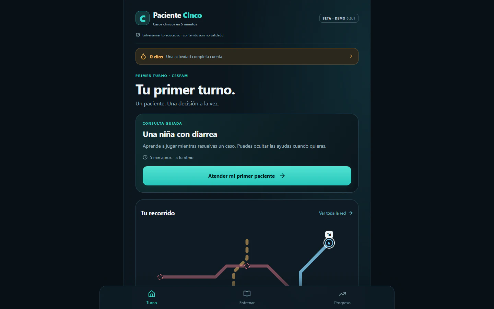

# Paciente Cinco

[English](README.md) · **Español**

**Casos clínicos en cinco minutos. Una decisión a la vez.**

Prototipo educativo para estudiantes, internos y médicos que quieren practicar con casos breves, tomar decisiones y revisar su razonamiento mediante retroalimentación.

[Jugar la demo](https://paciente-cinco-demo.pablo-aguirre.chatgpt.site)

**Beta educativa:** el contenido de demostración está pendiente de revisión clínica. La demo permite explorar la experiencia de aprendizaje; no acredita competencias ni está destinada a orientar la atención de pacientes.

<picture>
  <source media="(max-width: 600px)" srcset="assets/screenshots/turno-mobile.webp">
  
</picture>

Demo pública, 22 de octubre de 2026. Se conserva visible el aviso de beta. [Captura móvil (390 × 844, escala 2)](assets/screenshots/turno-mobile.webp) · [Procedencia de las capturas](assets/screenshots/README.md).

## La propuesta

Explorar una forma de practicar en sesiones cortas: presentar un caso, tomar decisiones y volver sobre lo aprendido. El recorrido combina consultas guiadas, actividades de práctica y repaso, con progreso guardado en el dispositivo.

## Qué puedes probar

- Un primer turno guiado en un entorno de atención primaria.
- Actividades con decisiones clínicas, ECG y reconocimiento de sonidos respiratorios.
- Retroalimentación y referencias para revisar las respuestas.
- Un mapa de aprendizaje, práctica y repaso.
- Continuación de actividades y consulta del progreso local.

## Qué demuestra esta presentación

La demo y las capturas permiten inspeccionar la interfaz y el recorrido inicial. No constituyen evidencia de exactitud clínica, aprendizaje efectivo ni competencia profesional. La descripción técnica procede de la documentación del autor; el código interno no es auditable desde este repositorio público.

## Estado del proyecto

La demo pública corresponde a la línea beta 0.5. La revisión clínica del contenido y las pruebas físicas en teléfonos siguen pendientes. No se ha evaluado todavía su efecto en el aprendizaje.

El código de desarrollo se mantiene privado. Esta presentación permite conocer y probar el proyecto sin acceso al repositorio interno.

## Mi aporte

**Dr. Pablo Aguirre Araya, médico general de zona en Arica.** Dirección del concepto educativo, definición de los recorridos y decisiones de producto, y desarrollo iterativo con apoyo de IA. La revisión clínica formal del contenido es una etapa pendiente.

## Diseño y tecnología

Aplicación web con TypeScript, React y Vite. El progreso se conserva en el navegador mediante IndexedDB. Incluye una estructura editorial que separa borradores, revisión y contenido elegible para distribución.

Las partidas no utilizan un chat generativo en tiempo real. Las respuestas y la retroalimentación dependen del contenido preparado para cada actividad.

## Límites de la demo

- Progreso local, sin cuentas ni sincronización entre dispositivos.
- Trazados ECG esquemáticos, no calibrados para diagnóstico.
- Solicitudes de revisión guardadas localmente y exportables; no se reciben automáticamente en un servidor.
- Algunas áreas del mapa representan desarrollo futuro.

## Qué quiero aprender con las pruebas

Si el primer turno se entiende, si las decisiones y la retroalimentación resultan claras y si es fácil retomar una actividad. Las primeras observaciones servirán para mejorar la experiencia antes de evaluar resultados educativos.

[Probar la demo](https://paciente-cinco-demo.pablo-aguirre.chatgpt.site) · [Enviar observaciones por correo](mailto:pablo.aguirre.araya@gmail.com)
