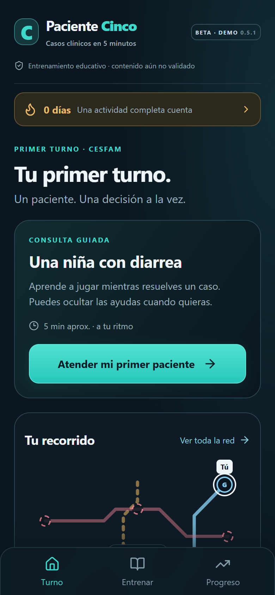
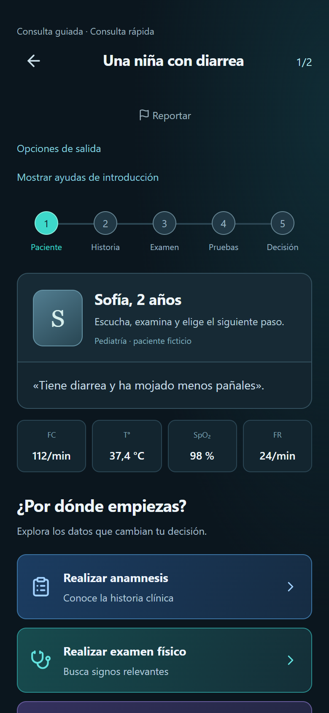

# Paciente Cinco

[Read in English](README.md) · **Español**

**Casos clínicos breves. Una decisión a la vez.**

Beta educativa para practicar razonamiento clínico mediante consultas guiadas, actividades breves y retroalimentación, con progreso guardado en el dispositivo.

[Probar la demo](https://paciente-cinco-demo.pablo-aguirre.chatgpt.site) · [Enviar comentarios](mailto:pablo.aguirre.araya@gmail.com)

**Beta jugable 0.5.1.** El contenido de demostración está pendiente de revisión clínica; su efecto educativo no se ha evaluado.

*Captura móvil real, 390 × 844 píxeles CSS. Interfaz en español.*

## Qué puedes probar

- Una primera consulta guiada, con historia, examen y decisiones.
- Actividades de decisiones clínicas, ECG esquemáticos y sonidos respiratorios.
- Retroalimentación y referencias preparadas, mapa de aprendizaje, repaso y progreso local.
- Reanudar actividades a tu ritmo; las sesiones buscan ser breves, sin funcionar como exámenes cronometrados.

## Dentro de un caso

*La demo identifica expresamente a la paciente como ficticia. [Ver la pantalla de anamnesis](assets/mobile-history.webp).*

## Implementado y planificado

La introducción guiada y las estaciones disponibles se pueden jugar. “General de zona” y “Hospitalario” aparecen **en preparación**; no son recorridos completos. Quedan pendientes la revisión de contenido, las pruebas en teléfonos físicos y la evaluación del aprendizaje.

## Alcance y tecnología

El código de desarrollo permanece privado; este repositorio contiene únicamente la presentación pública y las capturas. La app usa React, TypeScript y Vite, con IndexedDB para el progreso local. No tiene cuentas ni sincronización entre dispositivos.

Las respuestas y la retroalimentación son contenido preparado, sin chat generativo en vivo. Los ECG son esquemas, no registros diagnósticos. Las solicitudes de revisión se guardan localmente y pueden exportarse; no se envían automáticamente a un servidor. La beta no certifica competencias ni orienta la atención de pacientes reales.

## Mi aporte

Concepto educativo, recorridos de aprendizaje y decisiones de producto, con desarrollo iterativo asistido por IA. La revisión clínica formal sigue siendo una etapa independiente pendiente. **Pablo Aguirre Araya, médico en Chile.**

[Probar la demo](https://paciente-cinco-demo.pablo-aguirre.chatgpt.site) · [Detalles de las capturas](docs/screenshots.md)
